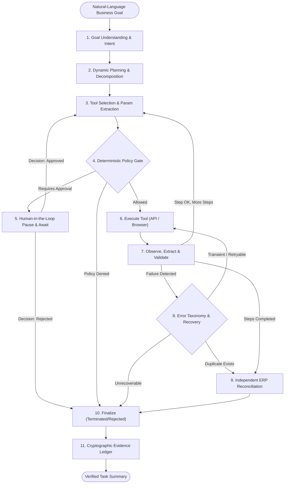

# Architecture Specification: Autonomous Enterprise Operations Worker

## 1. System Overview
The **Autonomous Enterprise Operations Worker** transforms unstructured, natural-language business directives into reliably executed, policy-compliant, and independently verified operations across enterprise ERP, finance, and file repositories.

Unlike probabilistic conversational bots or brittle scripting systems, the Autonomous Worker combines:
1. **Goal-directed planning & decomposition** with an LLM-backed or deterministic rule-assisted planner.
2. **Deterministic policy enforcement & human authorization gates** before any state-mutating operation.
3. **Task-scoped working memory** to eliminate redundant network round-trips.
4. **Resilient execution with an automated failure taxonomy & bounded retries**.
5. **Strict idempotency keys** guaranteeing exactly-once side effects even under network partitions.
6. **Decoupled post-write verification** that queries the target ledger directly and proves semantic compliance before claiming success.
7. **Cryptographic SHA-256 evidence ledger** providing auditable execution traces.

---

## 2. LangGraph State Machine Architecture

The worker's lifecycle is orchestrated via a directed state graph built on **LangGraph**. The state is strictly typed using `TypedDict` and immutable transition contracts.

### State Schema (`EnterpriseWorkerState`)

| State Field | Type | Description |
| :--- | :--- | :--- |
| `task_id` | `str` | Globally unique execution identifier (UUID4) |
| `user_goal` | `str` | Raw natural-language prompt provided by the operator |
| `interpreted_goal` | `Dict[str, Any]` | Extracted intent, vendor target, target action, approval policy thresholds |
| `plan` | `List[Dict[str, Any]]` | Ordered step list (`step_id`, `description`, `tool_name`, `status`) |
| `current_step_index`| `int` | Pointer to active plan item |
| `completed_steps` | `List[Dict[str, Any]]` | Historic ledger of successfully finished steps |
| `available_tools` | `List[str]` | Whitelist of tools registered and callable in current context |
| `selected_tool` | `Optional[str]` | Tool chosen for immediate execution |
| `tool_arguments` | `Dict[str, Any]` | Typed arguments synthesized for `selected_tool` |
| `observations` | `List[Dict[str, Any]]` | Cumulative telemetry stream of tool outputs and timestamps |
| `memory` | `Dict[str, Any]` | Working memory storing discovered vendor, invoice ID, amount, ERP record |
| `extracted_entities`| `Dict[str, Any]` | Normalized entity values (e.g., `vendor`, `invoice_id`, `amount`, `due_date`) |
| `risk_level` | `str` | Risk tier: `LOW`, `MEDIUM`, `HIGH`, `CRITICAL` |
| `approval_required` | `bool` | Flag indicating whether human approval is mandated |
| `approval_status` | `Optional[str]` | `PENDING`, `APPROVED`, or `REJECTED` |
| `approval_id` | `Optional[str]` | Identifier linking to the human decision record |
| `retry_count` | `int` | Counter of retries for the active step |
| `max_retries` | `int` | Hard bounded limit (default: 3) to prevent infinite cycles |
| `errors` | `List[Dict[str, Any]]` | Accumulated error records with taxonomy classification |
| `recovery_action` | `Optional[str]` | Next routing branch: `retry`, `replan`, `fail`, `proceed_to_verify` |
| `verification_requirements` | `Dict[str, Any]` | Field-level invariants required for target ledger validation |
| `verification_results` | `Optional[Dict[str, Any]]` | Independent verification output (`passed`, `mismatches`, `target_record`) |
| `evidence` | `List[Dict[str, Any]]` | Cryptographically signed telemetry and step receipts |
| `status` | `str` | Task status: `PLANNING`, `RUNNING`, `WAITING_FOR_APPROVAL`, `RECOVERING`, `VERIFYING`, `COMPLETED`, `FAILED` |
| `final_result` | `Optional[Dict[str, Any]]` | Final outcome payload formatted for enterprise UI presentation |

---

## 3. Node-by-Node Execution Protocol

### Node 1: `understand_goal`
- Normalizes operator intent.
- Identifies target vendor (e.g., `Acme`, `Contoso`, `Globex`), action verbs (`process`, `check`, `find`), and extracted constraints (e.g., `"approval above ₹100,000"`).
- Initializes working memory.

### Node 2: `create_plan`
- Synthesizes an ordered DAG of atomic sub-tasks:
  1. `locate_invoice`: Search company document store.
  2. `extract_and_validate`: Open invoice and extract vendor, ID, amount, date, currency.
  3. `precheck_finance`: Check internal ERP to detect existing records or duplicates.
  4. `enter_finance`: Submit new finance record into ERP ledger.
  5. `verify_ledger`: Read back and independently reconcile finance state.
- Stores step checklist into state.

### Node 3: `select_tool`
- Inspects `current_step_index` and active step definition.
- Pulls entity parameters from `memory` (e.g., `invoice_id`, `amount`, `vendor`).
- Computes idempotency key: `f"TASK-{task_id}-{invoice_id}-CREATE"` for write operations.
- Assigns tool risk level (`LOW` for read operations, `HIGH` for finance writes).

### Node 4: `authorize_policy`
- Deterministic policy engine checks tool call:
  - Is `finance_create_invoice` or high-value mutation requested?
  - Does invoice amount exceed policy threshold (e.g. > ₹100,000)?
  - Has approval already been granted? If yes, permits execution.
  - If required and not approved, switches status to `WAITING_FOR_APPROVAL` and routes to `request_approval`.

### Node 5: `request_approval`
- Creates persistent approval record in database.
- Suspends agent execution.
- Emits real-time event to Next.js operator console.
- Halts execution until operator submits `APPROVED` or `REJECTED`.

### Node 6: `execute_tool`
- Dispatches tool invocation to the Tool Registry:
  - **Invoice Tools**: File-system simulation & field extraction.
  - **Finance Tools**: ERP REST API with idempotency tracking and fault simulation.
  - **Browser Tools**: Headless/headed Playwright automation simulating human keyboard/mouse interaction on `/sandbox/finance`.

### Node 7: `observe_and_validate`
- Parses tool output into typed schemas.
- Updates working memory with discovered entities (`invoice_id`, `amount`, `finance_record_id`).
- Evaluates output for errors:
  - If tool failed (`success == False` or HTTP error), routes to `recover_or_replan`.
  - If step succeeded, advances `current_step_index`.
  - If all plan steps finished, routes to `verify_outcome`.

### Node 8: `recover_or_replan`
- Invokes Error Classification Engine:
  - `TRANSIENT` (e.g., HTTP 500, network timeout): Increments `retry_count`. If `retry_count <= max_retries`, waits with exponential backoff and routes back to `execute_tool`.
  - `DUPLICATE` (e.g., HTTP 409 conflict): Discovers existing record ID from conflict payload, writes to memory, skips redundant creation, and routes directly to `verify_outcome`.
  - `NOT_FOUND` / `VALIDATION_ERROR`: Adapts query parameters or marks step unrecoverable.
  - Exceeded retries: Marks task `FAILED` and routes to `complete_task`.

### Node 9: `verify_outcome`
- **Independent Reconciliation**: Does not trust the return status of the write tool.
- Issues a read query to the target ERP database using the recorded reference ID or invoice number.
- Validates 6 core fields:
  1. `invoice_id == expected_invoice_id`
  2. `vendor.lower() == expected_vendor.lower()`
  3. `amount == expected_amount`
  4. `currency == expected_currency`
  5. `status == "RECORDED"`
  6. `finance_record_id.startswith("FIN-")`
- Appends cryptographic hash of ERP record into state.

### Node 10: `emit_evidence`
- Generates SHA-256 integrity hash across all completed steps, policies, approvals, and verification assertions.
- Saves immutable audit bundle to database.

### Node 11: `complete_task`
- Formats structured human-readable completion summary.
- Signals completion to API and WebSocket/polling UI stream.

---

## 4. Multi-Modal Execution: API vs. Browser (Playwright)

The worker supports dual execution modalities for enterprise interactions:

1. **Direct ERP REST API**:
   - Ultra-fast, deterministic integration via `/api/v1/sandbox/finance/records`.
   - Used for headless batch processing, unit testing, and automated evaluation suites.

2. **Browser Automation via Playwright**:
   - Interacts with internal web portals (`/sandbox/finance`).
   - Simulates human data entry:
     - `browser_navigate`: Loads ERP portal.
     - `browser_type`: Enters invoice number, vendor, amount, due date into form inputs.
     - `browser_click`: Submits `"Record Invoice"` button.
     - `browser_read`: Extracts confirmed DOM table rows and reference IDs.
   - Ideal for legacy enterprise portals lacking dedicated REST APIs.

---

## 5. Security & Isolation Boundaries

1. **Zero External Lateral Movement**: All tools execute against synthetic sandboxed file stores and local ERP tables. No real company networks or external credentials are touched.
2. **Deterministic Enforcement Override**: The LLM *cannot* bypass policy rules. Policy authorization is executed by hardcoded Python logic (`packages/policies/rules.py`) that intercepts every tool call.
3. **Idempotency Protection**: Finance mutations mandate unique keys (`task_id + invoice_id + action`), preventing double-billing or duplicate ERP entries.
4. **Audit Immutability**: All decisions, approval events, and verification outcomes are hashed into the audit ledger.
